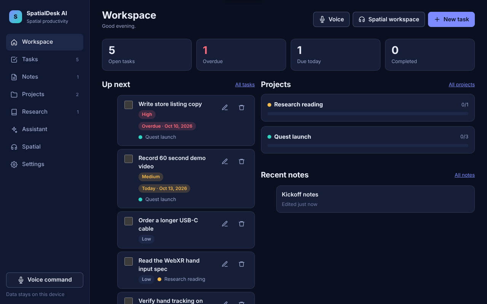
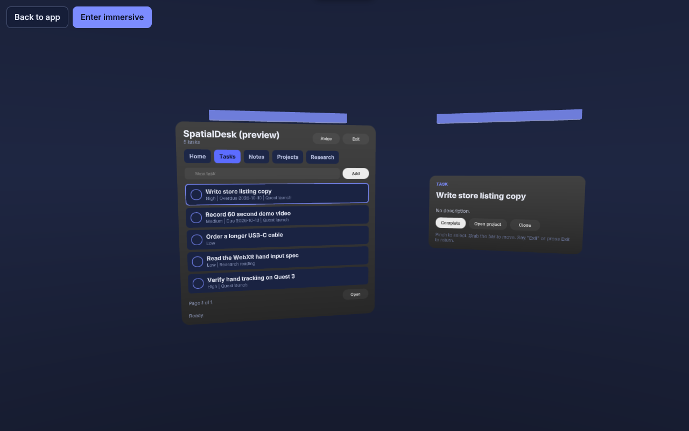

# SpatialDesk AI

[](https://github.com/0xjerome/SpatialDesk/actions/workflows/ci.yml)
[](https://render.com/deploy?repo=https://github.com/0xjerome/SpatialDesk)

SpatialDesk AI is a spatial productivity workspace for Meta Quest and the browser. Tasks, notes, projects and research live in one local-first workspace that you can use as an ordinary web app or as hand-driven panels in mixed reality, built on WebXR and Meta's Immersive Web SDK (IWSDK).

**Status at a glance**

| Outcome                                              | Status                                                                                                                             |
| ---------------------------------------------------- | ---------------------------------------------------------------------------------------------------------------------------------- |
| A. Working web application                           | Implemented and verified by automated browser tests                                                                                |
| B. Immersive experience verified on a physical Quest | **Not yet verified.** Implemented and verified in the IWSDK/IWER emulator only; see [docs/quest-testing.md](docs/quest-testing.md) |
| C. Published, reviewed or approved by Meta           | **No.** Nothing has been submitted                                                                                                 |





## What it does

- **Workspace home**: open, overdue and due-today counts, upcoming tasks, active projects and recent notes, all computed from stored data.
- **Tasks**: create, edit, complete, reopen and delete; title, description, status, priority, due date and project; search, filters and sorting; undo after delete.
- **Notes**: autosaving editor with unsaved-change protection, search, project links, and "Draft tasks" via the assistant.
- **Projects**: progress from real task completion, linked tasks/notes/research, delete with "keep and unlink" or cascade.
- **Research**: links with strict http(s) validation (never fetched or summarised behind your back), your own summaries, tags, project and note links.
- **Assistant** (optional, server-side key): organise tasks, draft tasks from a note, summarise pasted material, break a project into steps. Every result is validated twice (server and browser) and shown as a suggestion you apply explicitly.
- **Voice** (where the browser supports the Web Speech API): one-shot commands such as "add a task to call the dentist", always confirmed before anything changes.
- **Spatial workspace**: an IWSDK world with two UIKit panels (workspace list and detail), tabs for every area, quick add, task completion, movable panel handles, an in-panel voice flow, and clean session entry/exit. The same store backs the 2D app and the panels.
- **Settings**: theme, JSON export/import (merge or replace), delete-all with confirmation, and a plain-language privacy summary.

Data is stored in the browser's local storage on the device. There is no account system and no cloud sync; export/import is the way to move a workspace.

## Technology

| Layer      | Choice                                                                                                                                                                  |
| ---------- | ----------------------------------------------------------------------------------------------------------------------------------------------------------------------- |
| Build      | Vite 7, TypeScript (strict), ESLint 9, Prettier                                                                                                                         |
| Browser UI | Preact 10 + `@preact/signals`                                                                                                                                           |
| Immersive  | `@iwsdk/core` 1.0.1 (three.js r181 via `super-three`, `@pmndrs/uikit` Horizon kit, UIKitML panels), `@iwsdk/vite-plugin-dev` for the IWER Quest emulator in development |
| Server     | Node 22 `node:http` (no framework): static hosting, security headers, `/api/ai/*` proxy with the official `@anthropic-ai/sdk` and `zod` validation                      |
| Tests      | Vitest (unit/integration), Playwright (end-to-end, including emulated XR sessions)                                                                                      |

## Prerequisites

- Node.js 22 (see `.nvmrc`; Node 20.19+ and 24 also satisfy the engines range)
- npm 10
- For immersive testing: a Meta Quest with the Meta Quest Browser, see [docs/quest-testing.md](docs/quest-testing.md)

## Install and run

```sh
npm install
cp .env.example .env          # optional: add ANTHROPIC_API_KEY to enable the assistant
npm run dev:server            # API + static server on http://127.0.0.1:8787
npm run dev                   # Vite dev server on https://localhost:8081 (proxies /api to 8787)
```

Open <https://localhost:8081/>. The development certificate is self-signed (WebXR needs HTTPS off-localhost); accept the warning once. Set `SPATIALDESK_DEV_HTTPS=false` to use plain HTTP on localhost.

`npm run dev:managed` starts the IWSDK-managed session with the scene editor and MCP tooling (requires the `@iwsdk/cli` package and a Chromium download).

### Environment variables

All variables are read by the server only; nothing secret is ever shipped to the browser. See `.env.example`.

| Variable                   | Default                 | Purpose                                                                                                           |
| -------------------------- | ----------------------- | ----------------------------------------------------------------------------------------------------------------- |
| `PORT`                     | `8787`                  | Server port                                                                                                       |
| `HOST`                     | `0.0.0.0`               | Bind address                                                                                                      |
| `ANTHROPIC_API_KEY`        | empty                   | Enables the assistant. When empty the UI shows a clear "not configured" state and never sends data anywhere       |
| `ANTHROPIC_MODEL`          | `claude-opus-5-5`       | Claude model used by the assistant                                                                                |
| `AI_RATE_LIMIT_PER_MINUTE` | `20`                    | Per-client request budget for `/api/ai/assist`                                                                    |
| `ALLOWED_ORIGINS`          | empty                   | Extra origins allowed to call `/api` cross-origin (the Vite dev server proxies instead, so this is usually empty) |
| `SPATIALDESK_DEV_HTTPS`    | `true`                  | Set `false` for an HTTP dev server                                                                                |
| `SPATIALDESK_API_ORIGIN`   | `http://127.0.0.1:8787` | Where the dev proxy forwards `/api`                                                                               |

## Scripts

| Command                           | What it does                                                  |
| --------------------------------- | ------------------------------------------------------------- |
| `npm run dev`                     | Vite dev server with the Quest emulator injected on localhost |
| `npm run dev:server`              | Node API/static server                                        |
| `npm run build`                   | Production build into `dist/`                                 |
| `npm start`                       | Serve `dist/` and `/api` from Node (production)               |
| `npm run typecheck`               | `tsc` for the client, tests and the JS server (checkJs)       |
| `npm run lint` / `npm run format` | ESLint / Prettier check                                       |
| `npm test`                        | Vitest unit and integration tests                             |
| `npm run test:e2e`                | Playwright journeys (starts both servers automatically)       |
| `npm run verify`                  | typecheck + lint + unit tests + build                         |

## Using the browser app

Everything works offline after the first load. Keyboard navigation covers every control; dialogs are native `<dialog>` elements with focus management; reduced-motion preferences are respected; light and dark themes follow the system or the Settings choice.

## Immersive mode

1. Open the **Spatial** view. The device check lists secure context, WebGL, WebXR availability, and immersive-ar / immersive-vr support.
2. **Preview in browser** renders the same panels as a non-immersive 3D scene with mouse input.
3. **Enter mixed reality** requests an `immersive-ar` session (passthrough) with hand tracking as an optional feature; **Enter VR instead** requests `immersive-vr`. Failures (denied permission, no device) are reported in place; the app never shows an active session that does not exist.
4. In the session: point and pinch (or trigger) to press tabs, rows and buttons; the round toggle on a task row completes it; the blue bar above each panel is grabbable (`DistanceGrabbable`) to reposition it; **Voice** listens for one command and asks for confirmation; **Exit** ends the session. Leaving the Spatial view disposes the world.

Supported targets: Meta Quest Browser (Quest 2/3/3S/Pro) for immersive mode; any modern desktop or mobile browser for the 2D app and the 3D preview. Hand tracking must be enabled on the device; controllers always work.

Configuration lives in `iwsdk.config.json` (scene, XR features, emulator), `public/scenes/workspace.iwsdk.scene.json` (panel placement), `public/ui/*.uikitml` (panel markup) and `src/xr/` (runtime systems).

## AI and voice

- The assistant runs through `/api/ai/assist`. The server validates the request shape, applies a per-client rate limit, calls Claude with a JSON schema (`output_config.format`) and validates the response before returning it. Timeouts, rate limits, refusals, malformed output and missing credentials map to stable error codes the UI explains.
- Material is sent only when you press an assistant button, and only the material shown for that action. Settings describes this in plain language.
- Voice uses the browser's Web Speech API through a provider boundary (`src/voice/provider.ts`). Audio may be processed by the browser vendor; SpatialDesk itself never records audio. When unavailable, the voice controls are hidden and Settings explains why.

## Persistence

Records are stored under one versioned key in `localStorage` (`spatialdesk.workspace.v1`). Loading coerces each record individually, repairs dangling links and reports dropped records; a migration hook handles the pre-release shape. Writes are debounced and flushed on page hide. Private browsing or blocked storage falls back to in-memory for the session, and Settings says so. A full storage quota is reported with an explicit message instead of failing silently. When another tab of the same origin saves the workspace, a tab with no unsaved edits reloads it; a tab with pending edits keeps them and writes last (last writer wins).

## Deployment

The production artefact is `dist/` plus the `server/` directory.

```sh
npm ci && npm run build
ANTHROPIC_API_KEY=... PORT=8787 node server/index.js
```

Or with Docker: `docker build -t spatialdesk . && docker run -p 8787:8787 -e ANTHROPIC_API_KEY=... spatialdesk`.

### Render (one-click blueprint)

`render.yaml` describes a single Docker web service with the health check on `/api/health`.

1. Sign in to Render and press the **Deploy to Render** button above (or choose **New > Blueprint** and select this repository, branch `main`).
2. Render reads `render.yaml`; when prompted, enter `ANTHROPIC_API_KEY` (leave it empty to run without the assistant).
3. Deploy. The service gets an `https://<name>.onrender.com` URL with TLS, which satisfies WebXR's secure-context requirement.
4. Open `/api/health` on the new URL; it returns `{"ok":true,...,"assistant":"configured"|"not_configured"}`.

Behind any reverse proxy set `TRUST_PROXY` to the number of proxy hops (Render, Fly, a single nginx: `1`) so the per-client rate limit sees real client addresses; without it the limiter keys on the proxy's address. The blueprint sets it to `1`.

No deployment has been performed from this repository yet; the blueprint and image are prepared, and the production server journey in the end-to-end suite exercises the same build that Render would run.

Put HTTPS in front of the server (WebXR and the microphone require a secure context off-localhost). The server sets `Content-Security-Policy`, `Permissions-Policy` (`xr-spatial-tracking=(self)`, `microphone=(self)`), `X-Content-Type-Options`, `Referrer-Policy` and `X-Frame-Options`, serves hashed assets as immutable, and falls back to `index.html` for unknown extension-less paths. The CSP allows `connect-src` to `cdn.jsdelivr.net` because IWSDK loads controller models from the WebXR Input Profiles CDN.

Rollback is a redeploy of the previous `dist/` and `server/`; there is no database and no migration to reverse.

## Verification status

Run on 2026-10-13 in a Linux container (no GPU, no headset):

| Check              | Command                                                    | Result                                                                      |
| ------------------ | ---------------------------------------------------------- | --------------------------------------------------------------------------- |
| Type check         | `npm run typecheck`                                        | pass                                                                        |
| Lint               | `npm run lint`                                             | pass                                                                        |
| Format             | `npm run format`                                           | pass                                                                        |
| Unit / integration | `npm test`                                                 | 81 tests pass                                                               |
| Production build   | `npm run build`                                            | pass; entry chunk ~35 kB gzip, immersive runtime lazy-loaded (~1.7 MB gzip) |
| End-to-end         | `npm run test:e2e`                                         | 20 journeys pass, including emulated immersive-ar enter / exit / re-enter   |
| Dependency audit   | `npm audit`                                                | see Known limitations                                                       |
| Physical Quest     | manual, see [docs/quest-testing.md](docs/quest-testing.md) | **not performed**                                                           |

## Known limitations

- **No headset verification yet.** Hand-tracking comfort, text entry through the Quest system keyboard inside UIKit inputs, Web Speech availability in the Quest Browser, and frame rate are unverified on hardware.
- **Immersive bundle size.** `@iwsdk/core` with the Horizon kit pulls in the full Lucide icon set and MSDF fonts (about 6.5 MB raw, 1.7 MB gzip). It is loaded only when you open the Spatial view.
- **Controller models** are fetched from `cdn.jsdelivr.net` at session start; without internet access controllers still work but render without a model.
- **Local-only data.** There is no sync between devices.
- **Live assistant calls are untested here.** The proxy, validation and error handling are covered with a fake provider; no request was made to Anthropic in this environment because no API key was available.
- **The assistant needs a server.** Static hosting alone runs everything except AI features, which then show the "not configured" state.

## Project layout

```
server/            Node API + static server (ai.js, app.js, schemas.js, rate-limit.js)
src/domain/        Types, validation, queries, persistence, WorkspaceStore
src/app/           Preact UI (views, components, router, styles)
src/ai/            Browser client and response validators for /api/ai
src/voice/         Speech provider boundary and command parser
src/xr/            IWSDK world, panel system, session controller, asset manifest
public/scenes/     IWSDK scene JSON       public/ui/  UIKitML panels
tests/unit/        Vitest                 tests/e2e/  Playwright
docs/              Quest testing guide
```

## Licence

No licence file has been added yet, so the default "all rights reserved" applies until the maintainer chooses one. This is a pending decision, not an oversight to be filled in by contributors.

## Meta VR Start

Submission materials prepared from the verified state of the project are in [docs/meta-vr-start.md](docs/meta-vr-start.md). Nothing has been submitted to or approved by Meta.

## Maintainer

Jerome Ssenyonga ([@0xjerome](https://github.com/0xjerome)). Issues and pull requests are welcome at <https://github.com/0xjerome/SpatialDesk>.
